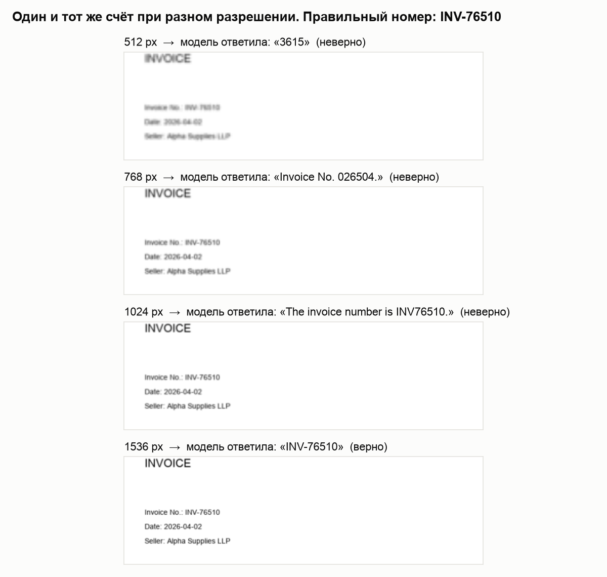
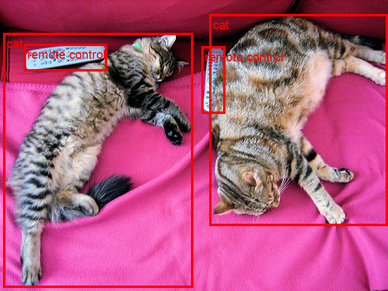
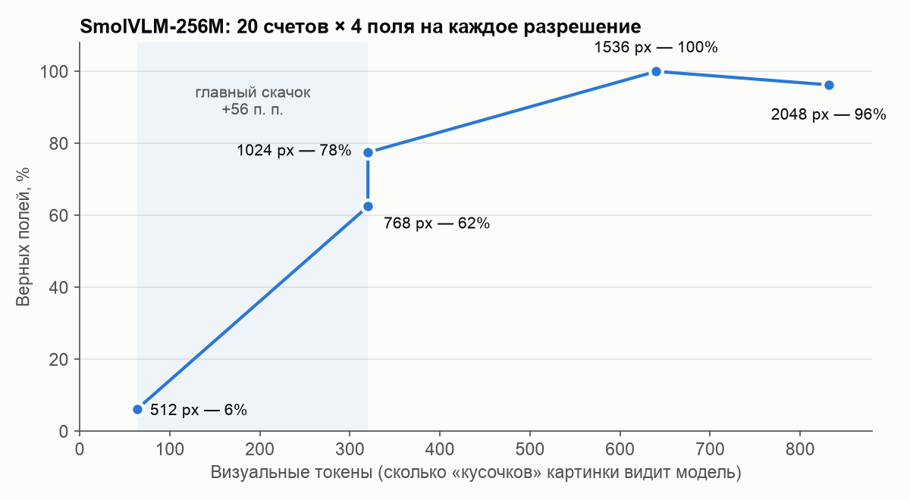
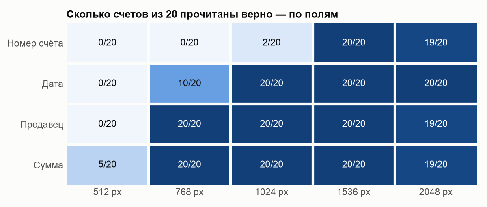

# Крошечные vision-language модели: где они ошибаются

Учебный практикум к лекции «LLM и компьютерное зрение». Маленькие открытые модели
запущены на MacBook (Apple M5, видеоядро через MPS, полная точность float32), их
ответы проверены кодом. Весь код, таблицы и выводы — в ноутбуке
[VLM_практикум_Mac.ipynb](VLM_практикум_Mac.ipynb).

**Главный вывод:** маленькая модель, которая плохо видит, не говорит «не вижу»,
а уверенно выдумывает правдоподобный ответ. Для документов разрешение картинки
важнее размера модели, а ответ модели нужно проверять кодом.

*Так счёт выглядит после сжатия до размера, который получает модель. При 512 px
номер не прочитать, и модель отвечает «3615»: это итоговая сумма счёта, а не номер.
При 1024 px модель уже видит номер, но теряет дефис. При 1536 px номер прочитан верно.*

## Что такое VLM — в двух словах

Показываешь картинку, задаёшь вопрос текстом и получаешь ответ текстом.
Внутри модели две части:

1. **«Глаза»** режут картинку на квадратики и превращают каждый в набор чисел —
   **визуальные токены**. Чем больше разрешение, тем больше токенов и деталей,
   но тем медленнее работает модель.
2. **«Язык»** читает эти токены вместе с вопросом и пишет ответ по одному слову,
   каждый раз выбирая *самое правдоподобное* продолжение. Отсюда и галлюцинации:
   модель выбирает то, что звучит правдоподобно, а не проверяет факты.

## Модели

| Модель | Размер | Что делает |
|---|---|---|
| [SmolVLM-256M-Instruct](https://huggingface.co/HuggingFaceTB/SmolVLM-256M-Instruct) | 256 млн параметров, ~1 ГБ | Отвечает на любой вопрос по картинке |
| [SmolVLM-500M-Instruct](https://huggingface.co/HuggingFaceTB/SmolVLM-500M-Instruct) | 500 млн, ~2 ГБ | То же, вдвое крупнее — для сравнения |
| [Florence-2-base](https://huggingface.co/florence-community/Florence-2-base) | 230 млн, ~1 ГБ | Не чат: по метке задачи находит объекты, ищет их по описанию, распознаёт текст (OCR) |

Для сравнения: у больших моделей вроде ChatGPT параметров в сотни и тысячи раз больше.

*Florence-2, задача `<OD>`. Рамки модель тоже выдаёт текстом — особыми токенами
координат, а рисует их уже обычный код.*

## Как проверяли

Ноутбук сам рисует **20 синтетических счетов** со случайными номером, датой,
продавцом и суммой. Правильные ответы известны заранее, поэтому каждый ответ
модели проверяется автоматически: на каждое разрешение приходится 80 ответов
(20 счетов × 4 поля). Ответ засчитывается, только если совпал символ в символ.

## Результаты пяти заданий

### 1. Галлюцинации: «Есть ли на картинке X?»

10 вопросов по картине Гольбейна «Послы»: 5 про то, что на ней есть, и 5 про то, чего нет.

| Модель | Верно | Выдумала отсутствующее | Не заметила существующее |
|---|---|---|---|
| SmolVLM-256M | 8 из 10 | 0 из 5 | 2 из 5 (человек, книга) |
| SmolVLM-500M | 10 из 10 | 0 из 5 | 0 из 5 |

На прямой вопрос модели не выдумывают. Зато на **наводящий** вопрос — сразу:
«Is there a dog?» → «No», а следующим ответом на «What color is the dog's collar?» →
«The dog has a white color collar».

### 2–3. Разрешение решает

- **64 → 320 визуальных токенов** — главный скачок: с 6 % до 62–78 % верных полей.
- **1536 px** — все 80 полей верны. Дальше качество не растёт: при 2048 px две ошибки
  из трёх сделал разбор ответа кодом, а не модель (`3,252` превратилось в `3`).
- **Номер счёта** читается хуже всего: это мелкие символы без смысловой подсказки.
  Модель теряет дефис или подставляет похожие цифры.
- У 768 и 1024 px одинаковое число токенов, но разное качество: при 768 px картинку
  сначала сжимают, и детали теряются (`2025` вместо `2026`).

### 4. Проверка ответа кодом без правильного ответа

| Разрешение | Ошибок модели | Поймала проверка формата | + проверка года и диапазона суммы |
|---|---|---|---|
| 1024 px | 18 | 18 | 18 |
| 2048 px | 3 | 1 | 2 |

Ложных тревог не было ни разу. Сломанный формат проверки ловят хорошо,
но правдоподобное неверное значение (`2026-10-22` вместо `2026-10-23`) пропускают.

### 5. Подсказка из OCR при плохом разрешении (512 px)

| Способ | Верных номеров из 20 |
|---|---|
| SmolVLM по картинке | 0 |
| SmolVLM по картинке + текст из OCR Florence-2 | 0 |
| Только OCR + регулярное выражение `INV-\d{5}` | 6 (+1 неверный, 13 «не найдено») |

Подсказка не помогла: Florence-2 сама прочитала номер верно лишь в 6 счетах из 20
(`IVY` вместо `INV`), а маленькая SmolVLM на длинной подсказке часто зацикливается
(`Invoice No. Invoice No. …`). Надёжнее схема «OCR + регулярное выражение»,
а VLM — только как дополнительная проверка.

## Как запустить

Нужен Python 3.12. Ячейки запускаются сверху вниз; первая ставит зависимости
(`torch`, `transformers==5.22.1` и др.), модели (~3 ГБ) скачиваются при первом запуске.
Устройство выбирается само: NVIDIA CUDA, Apple MPS или CPU.

В этом репозитории только ноутбук с сохранёнными результатами. Для полного
повторного запуска задания 1 нужна своя картинка вместо `ambassadors_source.jpeg`,
а ответы моделей будут посчитаны заново: кеш `vlm_selfstudy/responses.json` сюда не входит.
